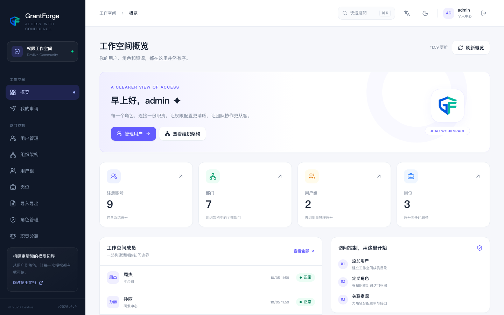

<!--
  Copyright (c) 2026 devlive-community/grantforge

  Licensed under the MIT License. See the LICENSE file in the
  project root for full license text.
-->

<div align="center">


# GrantForge

统一权限平台 · 用户、角色、菜单、接口、数据行与字段授权 · 外部数据系统

语言：[English](README.md) · 中文 · [繁體中文](README.zh-TW.md) · [Русский](README.ru.md) · [한국어](README.ko.md) · [日本語](README.ja.md) · [Deutsch](README.de.md) · [法语](README.fr.md) · [西班牙语](README.es.md) · [葡萄牙语](README.pt-BR.md) · [意大利语](README.it.md)

[](LICENSE)


[](https://grantforge.devlive.org)
[](https://ghcr.io/devlive-community/grantforge)

</div>

GrantForge（原 AuthX）是一个开源（MIT）的统一权限平台。它集中回答两个问题：**谁能做什么**（功能授权）和**谁能看到哪些数据**（数据与字段授权）。权限在控制台里定义、解释与审计，业务应用通过标准协议接入，外部数据系统（例如 HDFS）则通过插件与代理纳入同一套策略体系。

<p align="center">
  
</p>

## 功能

| 领域 | 功能 |
| --- | --- |
| 身份与组织 | 多租户、部门树、用户组与岗位；CSV 批量导入导出；LDAP / Active Directory 登录与同步、OIDC 联合登录 |
| 账号安全 | 会话管理与强制下线、密码策略与失败锁定、TOTP 两步验证与恢复码、敏感操作二次验证 |
| 功能授权 | 资源目录（模块、菜单、页面、标签、按钮、API）、角色继承、授权矩阵、授权影响分析 |
| 数据权限 | 按条件限定可见的数据行（本人、本部门及下级、指定部门、自定义条件），读与写分开控制 |
| 字段权限 | 字段可隐藏、可脱敏（邮箱、手机号、证件号等）、可只读 |
| 可解释与审计 | 权限解释（每项权限从哪来）、授权模拟、审计日志查询与导出 |
| 治理 | 职责分离（SOD）约束、权限申请与审批、定期权限复核 |
| 应用接入 | OAuth 2.1 / OIDC 授权服务器、权限查询开放 API、Java（Spring Boot Starter）与 JavaScript SDK |
| 外部系统 | 插件化服务类型与策略引擎：数据服务、访问策略、代理与访问审计 |
| 交付 | 单一可执行发行包、Docker 镜像、Compose 示例、Helm Chart；H2、PostgreSQL、MySQL、MariaDB、Oracle、SQL Server |

外部系统支持当前提供插件框架、策略编辑器、签名分发、访问审计，以及 HDFS、ZooKeeper、MySQL、Hive、Kafka、HBase、Trino、YARN、Pulsar、Solr、ClickHouse 和 PostgreSQL 服务插件。HDFS 使用编号 NameNode 代理，ZooKeeper 使用服务器内代理，MySQL 使用独立网络代理，Hive 使用 HiveServer2 内的授权器，Kafka 使用 broker 与 controller 内的授权器，HBase 使用 master 与 region server 内的协处理器，Trino 使用 coordinator 内的系统访问控制，YARN 使用 ResourceManager 内的授权提供者，Pulsar 使用 broker 内的授权提供者，Solr 使用节点内的授权插件，ClickHouse 使用服务器旁同步 ClickHouse 自身角色与行策略的服务，PostgreSQL 使用服务器旁同步 PostgreSQL 自身角色、权限与行安全策略的服务。MySQL 连接配置、数据库/表/列查询与策略能力见 [MySQL 插件指南](https://grantforge.devlive.org/plugins/mysql/)，部署方式与执行限制见 [MySQL 代理指南](https://grantforge.devlive.org/external/mysql-agent/)。Hive 见 [Hive 插件指南](https://grantforge.devlive.org/plugins/hive/)与 [Hive 代理指南](https://grantforge.devlive.org/external/hive-agent/)。Kafka 见 [Kafka 插件指南](https://grantforge.devlive.org/plugins/kafka/)与 [Kafka 代理指南](https://grantforge.devlive.org/external/kafka-agent/)。HBase 见 [HBase 插件指南](https://grantforge.devlive.org/plugins/hbase/)与 [HBase 代理指南](https://grantforge.devlive.org/external/hbase-agent/)。Trino 见 [Trino 插件指南](https://grantforge.devlive.org/plugins/trino/)与 [Trino 代理指南](https://grantforge.devlive.org/external/trino-agent/)。YARN 见 [YARN 插件指南](https://grantforge.devlive.org/plugins/yarn/)与 [YARN 代理指南](https://grantforge.devlive.org/external/yarn-agent/)。Pulsar 见 [Pulsar 插件指南](https://grantforge.devlive.org/plugins/pulsar/)与 [Pulsar 代理指南](https://grantforge.devlive.org/external/pulsar-agent/)。Solr 见 [Solr 插件指南](https://grantforge.devlive.org/plugins/solr/)与 [Solr 代理指南](https://grantforge.devlive.org/external/solr-agent/)。ClickHouse 见 [ClickHouse 插件指南](https://grantforge.devlive.org/plugins/clickhouse/)与 [ClickHouse 代理指南](https://grantforge.devlive.org/external/clickhouse-agent/)。PostgreSQL 见 [PostgreSQL 插件指南](https://grantforge.devlive.org/plugins/postgresql/)与 [PostgreSQL 代理指南](https://grantforge.devlive.org/external/postgresql-agent/)。


## 支持的组件与版本

下表为仓库集成测试实际运行过的版本，其他版本未经认证。

| 组件 | 服务插件 | 验证版本 | 执行代理 | 代理版本 | 代理 Java |
| --- | --- | --- | --- | --- | --- |
| Apache Hadoop HDFS | `plugins/grantforge-plugin-hdfs` | 2.7.7、2.10.2、3.2.4、3.3.6、3.4.3、3.5.0 | NameNode 代理 | 2.7、2.10、3.2、3.3、3.4、3.5 | 8（3.5：17） |
| Apache Hadoop YARN | `plugins/grantforge-plugin-yarn` | 3.2.4、3.3.6、3.4.3、3.5.0 | ResourceManager 授权提供者 | 与测试的 Hadoop 版本一致 | 8 |
| Apache Hive | `plugins/grantforge-plugin-hive` | HiveServer2 3.1.3、4.0.1、4.1.0 | HiveServer2 授权器 | 与测试的 HiveServer2 版本一致 | 8 |
| Apache Kafka | `plugins/grantforge-plugin-kafka` | 3.7.2、3.9.2、4.1.2、4.3.1 | Broker 与 Controller 授权器 | 与测试的 Kafka 版本一致 | 8 |
| Apache Pulsar | `plugins/grantforge-plugin-pulsar` | 3.0.17、3.3.9、4.0.14、4.2.5 | Broker 授权提供者 | 与测试的 Pulsar 版本一致 | 17 |
| Apache Solr | `plugins/grantforge-plugin-solr` | 9.8.1、9.10.1、9.11.0、10.0.0 | 节点授权插件 | 与测试的 Solr 版本一致 | 11 |
| ClickHouse | `plugins/grantforge-plugin-clickhouse` | 24.8、25.3、25.8、26.3、26.8 | 同步角色与行策略的服务 | 与测试的 ClickHouse 版本一致 | 17 |
| PostgreSQL | `plugins/grantforge-plugin-postgresql` | 15、16、17、18 | 同步角色、权限与行安全策略的服务 | 与测试的 PostgreSQL 版本一致 | 17 |
| Apache HBase | `plugins/grantforge-plugin-hbase` | 2.5.16、2.6.7、3.0.0 | Master 与 RegionServer 协处理器 | 与测试的 HBase 版本一致 | 8 |
| Trino | `plugins/grantforge-plugin-trino` | 470、476、479、484 | 系统访问控制 | 470（470 至 478）、479（479 及以后） | 23 / 25 |
| MySQL | `plugins/grantforge-plugin-mysql` | 8.0、8.4（不支持 MySQL 5.7 与 MariaDB 服务器） | 独立网络代理 | 单一代理 JAR | 17 |
| Apache ZooKeeper | `plugins/grantforge-plugin-zookeeper` | 仓库测试未列出 | 服务器内代理 | 3.6.4（编译依赖） | 8 |

**代理 Java** 列为各代理编译的字节码目标版本。HDFS 代理按 Hadoop 版本线选择（例如 Hadoop 2.10.2 使用 `agents/hdfs/2.10/`），完整说明见 [HDFS 代理指南](https://grantforge.devlive.org/zh/external/hdfs-agent/)。Hadoop 2.7、2.10、3.2 与 3.3 不提供超级用户授权回调，因此这些版本线上的超级用户访问仍由 Hadoop 控制。

## 工作原理：两个平面

- **管理平面**：GrantForge 服务端（Spring Boot 4.1，Java 17 字节码）与 Vue 3 控制台，负责租户、账号、组织、角色、授权、审计，以及数据服务与策略的维护。
- **数据平面**：嵌入受保护系统或独立部署在网络访问链路上的代理。代理凭令牌定期从服务端拉取带 Ed25519 签名的策略快照并缓存在本地，在访问之前执行资源授权并上报审计事件。服务端暂时不可达时继续使用已应用的快照；具体检查范围见各代理指南。

自己的系统不必照抄 HDFS 的做法：普通业务应用用开放 API 或 Spring Boot Starter 在进程内求值即可，需要在数据库、文件系统等存储系统内部或网络访问链路上拦截访问时，才需要用 `core/grantforge-agent-core` 编写代理。

## 接入你的应用

- **OAuth 2.1 / OpenID Connect**：GrantForge 本身就是授权服务器，应用用它登录用户；已有的身份源（LDAP / AD / OIDC）也可以接进来。
- **Java 应用**：`sdk/grantforge-spring-boot-starter` 提供 `@RequirePermission` 接口鉴权、`@GrantForgeEntity` 声明数据实体，以及 `GrantForgeDataScopes.scope(...)` 把平台上的数据权限转成 JPA `Specification`。
- **前端应用**：`@grantforge/client` 用 OIDC + PKCE 从你自己的域名引导用户登录，并查询当前用户的权限。
- **开放 API**：`/api/v1/open/me/authorization`、`/api/v1/open/me/data-access`、`/api/v1/open/catalog/data-entities`。
- **可运行的例子**：`samples/` 下的 `shop` 与 `notes` 两个应用按第三方的方式接入。

## 快速开始

需要 Java 17 或更高版本。服务默认监听 `9999` 端口，首次启动会在日志里打印一次性的**初始化令牌**；用浏览器打开 <http://127.0.0.1:9999/>，填入令牌并创建第一个管理员即可。

```bash
# 使用发行包（或从源码 ./mvnw clean package 构建，产物在 dist/）
tar -xzf grantforge-release.tar.gz
cd grantforge
bin/startup.sh

# 或使用 Docker
docker run -p 9999:9999 ghcr.io/devlive-community/grantforge:2026.0.0

# 或用 Compose 搭配数据库
docker compose -f deploy/compose/postgres.yml up -d

# 或部署到 Kubernetes
helm install grantforge deploy/helm/grantforge \
    --set database.url=jdbc:postgresql://postgresql:5432/grantforge \
    --set database.username=grantforge \
    --set encryptionKey=$(openssl rand -base64 32)
```

默认使用内嵌 H2 文件库，无需任何配置即可启动。MySQL 驱动因 GPL 许可不随发行包分发，需要自行放进 `drivers/`。安装、初始化与第一次授权的详细步骤见[文档站](https://grantforge.devlive.org)。

## 数据库

默认使用内嵌 H2 文件库（`${GRANTFORGE_HOME}/data`），无需任何配置即可启动。生产环境通过环境变量切换，库表结构由 Liquibase 统一管理：

| 数据库 | 版本（CI 验证） | `GRANTFORGE_DB_URL` 示例 |
| --- | --- | --- |
| PostgreSQL | 14、17 | `jdbc:postgresql://host:5432/grantforge` |
| MySQL | 8.0、8.4 | `jdbc:mysql://host:3306/grantforge`（需自行将 `mysql-connector-j` 放入 `lib/`，其 GPL 许可不随发行包分发） |
| MariaDB | 10.11、11.4 | `jdbc:mariadb://host:3306/grantforge` |
| Oracle | 23 | `jdbc:oracle:thin:@//host:1521/FREEPDB1` |
| SQL Server | 2022 | `jdbc:sqlserver://host:1433;databaseName=grantforge;encrypt=true` |

同时设置 `GRANTFORGE_DB_USER`、`GRANTFORGE_DB_PASSWORD`；集群部署时每个实例必须设置不同的 `GRANTFORGE_ID_NODE`（0-1023）。


## 运维与可观测性

- 健康探针：`/actuator/health/liveness`、`/actuator/health/readiness`（仅返回状态，不暴露细节；就绪探针在数据库可用且迁移完成后才返回 200）。
- 指标：`/actuator/prometheus`（带 `application="grantforge"` 标签，默认需要登录，可用 `GRANTFORGE_PROMETHEUS_PUBLIC=true` 对受信网络开放）。
- 日志：默认可读文本，每行带请求编号；设置 `LOGGING_STRUCTURED_FORMAT_CONSOLE=ecs`（或 `logstash`）输出 JSON 日志。
- 发行包脚本：`bin/` 下的 `startup.sh`、`shutdown.sh`、`restart.sh`、`debug.sh` 与 `import-legacy.sh`。

## 开发与验证

构建需要 JDK 17 或更高版本。服务端和 Hadoop 3.5 适配器目标为 Java 17；策略引擎、代理核心及 Hadoop 2.7–3.4 适配器目标为 Java 8。JDK 21+ 自动启用 Error Prone + NullAway。前端使用 Vue 3.5、Tailwind CSS 4、Node.js 22.12+ 和 pnpm 8.10.2。

```sh
# Java 构建与单元测试（跳过前端构建）
./mvnw verify
bash script/ci/java.sh test
bash script/ci/java.sh checkstyle

# 在指定数据库上运行持久化集成测试（需要 Docker，h2 除外）
bash script/ci/db_integration.sh postgres:17

# 打包发布包（包含前端构建），输出到 dist/
./mvnw clean package

# 前端开发与检查
bash script/ci/web.sh install
cd core/grantforge-web && pnpm dev
bash script/ci/web.sh lint

# 示例应用与 SDK
cd sdk/grantforge-js && pnpm install && pnpm build
./mvnw -f samples/pom.xml package -DskipTests

# API 契约：服务端接口变更后重新生成 openapi.json 与前端类型（CI 会校验两者一致）
./mvnw -DskipFrontend -pl core/grantforge-server -am test -Dtest=OpenApiContractTest \
    -Dsurefire.failIfNoSpecifiedTests=false -Dgrantforge.openapi.update=true
cd core/grantforge-web && pnpm api:generate

# 文档站（docs/，Next.js + Tailwind CSS）
bash script/ci/docs.sh install
cd docs && pnpm dev                 # http://localhost:3100
bash script/ci/docs.sh check
bash script/docs/screenshots.sh     # 用真实服务与示例数据重新生成文档截图

# 仓库检查（与 CI 相同）
python3 script/ci/check_license_headers.py
bash script/ci/test_ci_scripts.sh
```

## 项目链接

- [项目仓库](https://github.com/devlive-community/grantforge)
- [文档站](https://grantforge.devlive.org)：快速开始、使用指南、应用接入与技术文档，源文件在 [`docs/`](docs/)
- [贡献指南](CONTRIBUTING.md) · [行为准则](CODE_OF_CONDUCT.md) · [更新日志](CHANGELOG)
