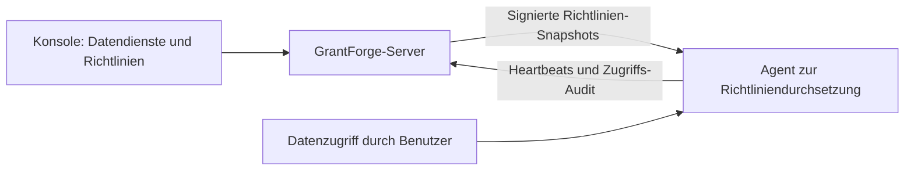

<!--
  Copyright (c) 2026 devlive-community/grantforge

  Licensed under the MIT License. See the LICENSE file in the
  project root for full license text.
-->

Die Gruppe „Datenberechtigungen“ verwaltet die Berechtigungen für Datensysteme außerhalb von GrantForge. Die Architektur ähnelt der von Apache Ranger: Plug-ins definieren Diensttypen, Administratoren schreiben Richtlinien in der Konsole, und die Agenten im Zugriffspfad laden die Richtlinien herunter und entscheiden Zugriffe lokal.

> [!NOTE]
> Die aktuelle Version bietet das Plug-in-Framework, den allgemeinen Richtlinien-Editor, signierte Richtlinienverteilung und Zugriffs-Audit sowie Dienst-Plug-ins und Agenten für HDFS, ZooKeeper und MySQL. Die Hadoop-Versionskompatibilität beschreibt der [Apache Hadoop HDFS-NameNode-Agent](/de/external/hdfs-agent/). MySQL verwendet einen eigenständigen Netzwerk-Proxy, mit dem sich Clients verbinden; siehe [MySQL-Proxy-Agent](/de/external/mysql-agent/).

## Plug-ins

**Plattformverwaltung → Plug-ins** listet die geladenen Diensttyp-Plug-ins. Integrierte Plug-ins werden mit dem Server ausgeliefert; für alle anderen Plug-ins genügt es, sie in das Verzeichnis `plugins` zu legen und auf „Neu einlesen“ zu klicken. Jedes Plug-in wird unabhängig geladen, ein Fehler deaktiviert nur es selbst. Zur Plug-in-Entwicklung siehe [Plug-ins und Diensttypen](/de/develop/plugins/).

## HDFS

Die Distribution enthält das HDFS-Diensttyp-Plug-in; Installation, Verbindungseinstellungen, Verzeichnissuche und Pfadrichtlinien stehen unter [Apache Hadoop HDFS](/de/plugins/hdfs/).

## MySQL

Das MySQL-Dienst-Plug-in übernimmt Verbindungsprüfung, Datenbank-/Tabellen-/Spaltensuche und die Verwaltung von Zugriffs-, Spaltenmaskierungs- und Zeilenfilterrichtlinien; siehe [MySQL](/de/plugins/mysql/). Ein separat bereitgestellter [MySQL-Proxy-Agent](/de/external/mysql-agent/) setzt die Richtlinien durch: Clients verbinden sich mit dem Proxy, der auf den MySQL-Backend-Server zugreift. Er wird nicht im MySQL-Serverprozess installiert; direkte Clientverbindungen zum Backend umgehen die GrantForge-Richtlinien.

## Datendienste

**Datenberechtigungen → Datendienste**: Ein Dienst ist eine Instanz eines externen Systems, dessen Berechtigungen GrantForge verwaltet, zum Beispiel ein HDFS-Cluster. Wähle beim Hinzufügen eines Dienstes den Diensttyp und fülle die Verbindungsdaten gemäß den vom Plug-in definierten Konfigurationspunkten aus; vorab kannst du **Verbindung testen**. Sensible Konfiguration wie Passwörter wird verschlüsselt gespeichert und nach dem Speichern nicht mehr angezeigt.

## Richtlinien

**Datenberechtigungen → Richtlinien** entscheiden, wer mit welchen Ressourcen in einem Datendienst was tun darf:

- **Zugriffsrichtlinien** erlauben oder verweigern den Zugriff;
- **Maskierungsrichtlinien** verdecken Felder;
- **Zeilenfilterrichtlinien** lassen nur einen Teil der Zeilen durch.

Die Ressourcenhierarchie (zum Beispiel Datenbanken, Tabellen und Spalten in MySQL), die Zugriffsarten (zum Beispiel select und update) und die Bedingungen stammen alle aus dem Plug-in des Diensttyps; beim Ausfüllen einer Ressource kannst du nach Ressourcen suchen, die im Zielsystem tatsächlich existieren. Richtlinien gelten für Benutzer, Gruppen oder Rollen.

Ebenen, die sich durchsuchen lassen, etwa HDFS-Pfade, haben die Schaltfläche **Durchsuchen**: Öffnen Sie Verzeichnisse Ebene für Ebene, sehen Sie Besitzer, Gruppe und Berechtigungen und wählen Sie mehrere Dateien oder Verzeichnisse auf einmal. Schlägt eine Suche oder das Durchsuchen fehl, wird der Grund angezeigt (keine Berechtigung, nicht erreichbar oder zu großes Verzeichnis), und Sie können es erneut versuchen.

## Agenten

**Datenberechtigungen → Agenten**: Agenten laufen innerhalb des Zielsystems oder als eigenständige Netzwerk-Proxys, melden mit ihrem Token regelmäßig einen Heartbeat und laden signierte Richtlinien-Snapshots herunter, um Zugriffe lokal zu entscheiden. Hier werden Agenten-Token ausgestellt (nur einmal angezeigt) und du siehst, ob jeder Agent die neuesten Richtlinien bereits übernommen hat.

## Zugriffs-Audit

**Datenberechtigungen → Zugriffs-Audit**: Jede von einem Agenten gemeldete Zugriffsentscheidung: wer hat wann von wo aus was mit welcher Ressource getan, wurde es erlaubt oder verweigert, und welche Richtlinie hat entschieden. Datensätze werden standardmäßig 90 Tage aufbewahrt.

