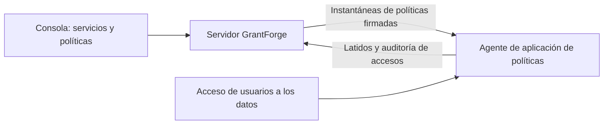

<!--
  Copyright (c) 2026 devlive-community/grantforge

  Licensed under the MIT License. See the LICENSE file in the
  project root for full license text.
-->

El grupo "Permisos sobre los datos" gestiona los permisos de los sistemas de datos ajenos a GrantForge, con una arquitectura similar a la de Apache Ranger: los plug-ins definen los tipos de servicio, los administradores escriben las políticas en la consola y los agentes en la ruta de acceso descargan las políticas y deciden el acceso localmente.

> [!NOTE]
> La versión actual ofrece el marco de plug-ins, el editor de políticas general, la distribución firmada de políticas y la auditoría de accesos, con plug-ins de servicio y agentes para HDFS, ZooKeeper y MySQL. Consulta el [Agente NameNode de Apache Hadoop HDFS](/es/external/hdfs-agent/) para la compatibilidad de versiones Hadoop. MySQL utiliza un proxy de red independiente al que se conectan los clientes; consulta el [Agente proxy de MySQL](/es/external/mysql-agent/).

## Plug-ins

**Administración de la plataforma → Plug-ins** lista los plug-ins de tipos de servicio cargados. Los plug-ins integrados se proporcionan con el servidor; los demás plug-ins se colocan en el directorio `plugins` y luego se pulsa "Volver a buscar"; cada plug-in se carga de forma independiente y, si falla, solo se desactiva a sí mismo. El desarrollo de plug-ins se describe en [Plug-ins y tipos de servicio](/es/develop/plugins/).

## HDFS

La distribución incluye el plug-in de tipo de servicio HDFS; la instalación, la configuración de conexión, la exploración de directorios y las políticas de rutas se describen en [Apache Hadoop HDFS](/es/plugins/hdfs/).

## MySQL

El plug-in de servicio MySQL valida la conexión, busca bases de datos, tablas y columnas, y gestiona políticas de acceso, enmascaramiento de columnas y filtrado de filas; consulta [MySQL](/es/plugins/mysql/). Un [Agente proxy de MySQL](/es/external/mysql-agent/) desplegado por separado aplica las políticas: los clientes se conectan a la dirección de escucha del proxy, que accede al servidor MySQL de destino. No se instala dentro del proceso de MySQL; las conexiones directas al servidor eluden las políticas de GrantForge.

## Servicios de datos

**Permisos sobre los datos → Servicios de datos**: un servicio es una instancia de un sistema externo cuyos permisos administra GrantForge, por ejemplo un cluster de HDFS. Al añadir un servicio se elige el tipo de servicio y se rellenan los datos de conexión según los elementos de configuración definidos por el plug-in; antes puedes **probar la conexión**. La configuración sensible, como las contraseñas, se guarda cifrada y ya no se muestra después de guardar.

## Políticas

**Permisos sobre los datos → Políticas** decide quién puede hacer qué sobre los recursos de un servicio de datos:

- Las **políticas de acceso** permiten o deniegan el acceso.
- Las **políticas de enmascaramiento** ocultan campos.
- Las **políticas de filtrado de filas** solo dejan pasar algunas filas.

La jerarquía de recursos (en MySQL, bases de datos, tablas y columnas, por ejemplo), los tipos de acceso (select, update, por ejemplo) y las condiciones provienen del plug-in del tipo de servicio; al escribir el recurso puedes buscar los recursos que existen realmente en el sistema de destino. Las políticas se aplican a usuarios, grupos de usuarios o roles.

Los niveles que se pueden explorar, como las rutas de HDFS, tienen un botón **Explorar**: abra directorios nivel a nivel, vea su propietario, grupo y permisos, y elija varios archivos o directorios a la vez. Si una búsqueda o la exploración fallan, se muestra el motivo (sin permiso, inaccesible o directorio demasiado grande) y puede reintentarlo.

## Agentes

**Permisos sobre los datos → Agentes**: los agentes se ejecutan dentro del sistema de destino o como proxies de red independientes; con un token envían periódicamente un latido y descargan una instantánea de políticas firmada, y deciden el acceso localmente. Aquí se emiten los tokens de agente (se muestran una sola vez) y se consulta si cada agente ya usa las últimas políticas.

## Auditoría de accesos

**Permisos sobre los datos → Auditoría de accesos**: cada decisión de acceso que informa un agente —quién hizo qué, cuándo, desde dónde y sobre qué recurso, si se permitió o se denegó el acceso y qué política lo decidió. Los registros se conservan 90 días por defecto.

