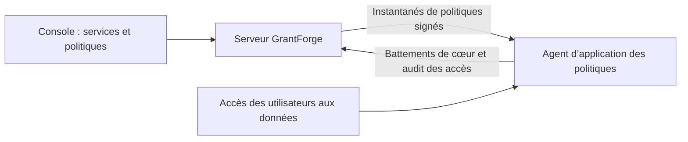

<!--
  Copyright (c) 2026 devlive-community/grantforge

  Licensed under the MIT License. See the LICENSE file in the
  project root for full license text.
-->

Le groupe « autorisations sur les données » gère les autorisations des systèmes de données extérieurs à GrantForge. L’architecture ressemble à celle d’Apache Ranger : les plug-ins définissent les types de service, les administrateurs rédigent les politiques dans la console, et les agents placés sur le chemin d’accès téléchargent les politiques et décident des accès localement.

> [!NOTE]
> La version actuelle fournit le cadre de plug-ins, l’éditeur de politiques générique, la distribution signée des politiques et l’audit des accès, avec les plug-ins de service HDFS, ZooKeeper et MySQL et leurs agents. Consultez l’[Agent NameNode Apache Hadoop HDFS](/fr/external/hdfs-agent/) pour la compatibilité des versions Hadoop. MySQL utilise un proxy réseau autonome auquel les clients se connectent ; voir l’[Agent proxy MySQL](/fr/external/mysql-agent/).

## Plug-ins

**Administration de la plateforme → Plug-ins** liste les plug-ins de types de service chargés. Les plug-ins intégrés sont fournis avec le serveur ; pour les autres, il suffit de les déposer dans le répertoire `plugins` puis de cliquer sur « relancer l’analyse ». Chaque plug-in est chargé indépendamment : en cas d’erreur, seul ce plug-in est désactivé. Pour le développement de plug-ins, voir [Plug-ins et types de service](/fr/develop/plugins/).

## HDFS

La distribution inclut le plug-in de type de service HDFS ; l’installation, les paramètres de connexion, la navigation dans les répertoires et les politiques de chemins sont décrits dans [Apache Hadoop HDFS](/fr/plugins/hdfs/).

## MySQL

Le plug-in de service MySQL assure la validation de la connexion, la recherche de bases, tables et colonnes, et la gestion des politiques d’accès, de masquage des colonnes et de filtrage des lignes ; voir [MySQL](/fr/plugins/mysql/). Un [Agent proxy MySQL](/fr/external/mysql-agent/) déployé séparément applique les politiques : les clients se connectent à son adresse d’écoute, puis le proxy accède au serveur MySQL en arrière-plan. Il n’est pas installé dans le processus du serveur MySQL ; les connexions directes au serveur contournent les politiques GrantForge.

## Services de données

**Autorisations sur les données → Services de données** : un service est une instance d’un système externe dont GrantForge gère les autorisations, par exemple un cluster HDFS. À l’ajout d’un service, choisissez le type de service et renseignez les informations de connexion selon les points de configuration définis par le plug-in ; vous pouvez d’abord **tester la connexion**. Les configurations sensibles comme les mots de passe sont enregistrées chiffrées et ne sont plus affichées après l’enregistrement.

## Politiques

**Autorisations sur les données → Politiques** décident qui peut faire quoi sur quelles ressources d’un service de données :

- **les politiques d’accès** autorisent ou refusent un accès ;
- **les politiques de caviardage** masquent des champs ;
- **les politiques de filtrage de lignes** ne laissent passer qu’une partie des lignes.

La hiérarchie des ressources (bases, tables et colonnes dans MySQL, par exemple), les types d’accès (select, update, par exemple) et les conditions viennent tous du plug-in du type de service ; lors de la saisie d’une ressource, vous pouvez rechercher les ressources qui existent réellement dans le système cible. Les politiques s’appliquent aux utilisateurs, groupes ou rôles.

Les niveaux que l’on peut parcourir, comme les chemins HDFS, ont un bouton **Parcourir** : ouvrez les répertoires niveau par niveau, consultez propriétaire, groupe et permissions, et choisissez plusieurs fichiers ou répertoires à la fois. Si une recherche ou un parcours échoue, le motif s’affiche (pas de permission, injoignable ou répertoire trop grand) et vous pouvez réessayer.

## Agents

**Autorisations sur les données → Agents** : les agents s’exécutent dans le système cible ou comme proxys réseau autonomes ; munis d’un jeton, ils envoient régulièrement un battement de cœur et téléchargent un instantané de politiques signé, puis décident des accès localement. C’est ici que l’on émet les jetons d’agent (affichés une seule fois) et que l’on voit si chaque agent utilise déjà les dernières politiques.

## Audit des accès

**Autorisations sur les données → Audit des accès** : chaque décision d’accès rapportée par un agent — qui a fait quoi, quand, depuis où, sur quelle ressource, si l’accès a été autorisé ou refusé, et quelle politique l’a décidé. Les enregistrements sont conservés 90 jours par défaut.

