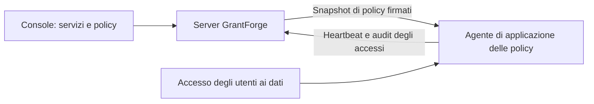

<!--
  Copyright (c) 2026 devlive-community/grantforge

  Licensed under the MIT License. See the LICENSE file in the
  project root for full license text.
-->

Il gruppo “Permessi sui dati” gestisce i permessi dei sistemi di dati esterni a GrantForge, con un’architettura simile a quella di Apache Ranger: i plug-in definiscono i tipi di servizio, gli amministratori scrivono le policy nella console e gli agenti nel percorso di accesso scaricano le policy e decidono l’accesso localmente.

> [!NOTE]
> La versione attuale fornisce il framework dei plug-in, l’editor di policy generico, la distribuzione firmata delle policy e l’audit degli accessi, con plug-in di servizio e agenti per HDFS, ZooKeeper e MySQL. Per la compatibilità delle versioni Hadoop, consulta l’[Agente NameNode Apache Hadoop HDFS](/it/external/hdfs-agent/). MySQL usa un proxy di rete autonomo a cui si collegano i client; vedi l’[Agente proxy MySQL](/it/external/mysql-agent/).

## Plug-in

**Gestione della piattaforma → Plug-in** elenca i plug-in di tipi di servizio caricati. I plug-in integrati vengono forniti con il server; gli altri plug-in si mettono nella directory `plugins` e poi si fa clic su “Ripeti scansione”; ogni plug-in viene caricato in modo indipendente e, se fallisce, viene disattivato solo lui. Lo sviluppo dei plug-in è descritto in [Plug-in e tipi di servizio](/it/develop/plugins/).

## HDFS

La distribuzione include il plug-in del tipo di servizio HDFS; installazione, impostazioni di connessione, esplorazione delle directory e policy dei percorsi sono descritti in [Apache Hadoop HDFS](/it/plugins/hdfs/).

## MySQL

Il plug-in di servizio MySQL verifica la connessione, cerca database, tabelle e colonne e gestisce le policy di accesso, mascheramento delle colonne e filtro delle righe; vedi [MySQL](/it/plugins/mysql/). Un [Agente proxy MySQL](/it/external/mysql-agent/) distribuito separatamente applica le policy: i client si collegano all’indirizzo di ascolto del proxy, che accede al server MySQL di backend. Non viene installato nel processo del server MySQL; le connessioni dirette al backend aggirano le policy di GrantForge.

## Servizi di dati

**Permessi sui dati → Servizi di dati**: un servizio è un’istanza di un sistema esterno i cui permessi GrantForge gestisce, per esempio un cluster HDFS. Quando si aggiunge un servizio si sceglie il tipo di servizio e si compilano i dati di connessione secondo le voci di configurazione definite dal plug-in; prima si può fare il **Test di connessione**. Le configurazioni sensibili, come le password, vengono salvate cifrate e non vengono più mostrate dopo il salvataggio.

## Policy

**Permessi sui dati → Policy** decidono chi può fare cosa sulle risorse di un servizio di dati:

- le **policy di accesso** consentono o negano l’accesso;
- le **policy di mascheramento** nascondono i campi;
- le **policy di filtro delle righe** lasciano passare solo alcune righe.

La gerarchia delle risorse (in MySQL, database, tabelle e colonne, per esempio), i tipi di accesso (per esempio select, update) e le condizioni provengono tutti dal plug-in del tipo di servizio; quando si compila la risorsa si possono cercare le risorse che esistono realmente nel sistema di destinazione. Le policy hanno come oggetto utenti, gruppi di utenti o ruoli.

I livelli esplorabili, come i percorsi HDFS, hanno un pulsante **Sfoglia**: apra le directory livello per livello, veda proprietario, gruppo e permessi e scelga più file o directory insieme. Se una ricerca o l’esplorazione non riesce, ne viene mostrato il motivo (permesso mancante, irraggiungibile o directory troppo grande) e può riprovare.

## Agenti

**Permessi sui dati → Agenti**: gli agenti vengono eseguiti nel sistema di destinazione o come proxy di rete autonomi; con un token inviano periodicamente un battito e scaricano un’istantanea delle policy firmata, e decidono l’accesso localmente. Qui si emettono i token degli agenti (mostrati una sola volta) e si verifica se ogni agente ha già adottato le policy più recenti.

## Audit degli accessi

**Permessi sui dati → Audit degli accessi**: ogni decisione di accesso segnalata da un agente: chi ha fatto cosa, quando, da dove e su quale risorsa, se l’accesso è stato consentito o negato e quale policy l’ha deciso. Le registrazioni vengono conservate per 90 giorni per impostazione predefinita.

