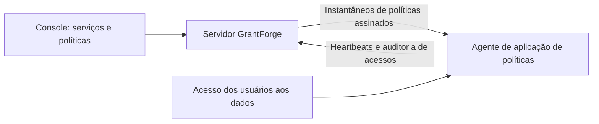

<!--
  Copyright (c) 2026 devlive-community/grantforge

  Licensed under the MIT License. See the LICENSE file in the
  project root for full license text.
-->

O grupo "Permissões de dados" gerencia as permissões dos sistemas de dados externos ao GrantForge, com uma arquitetura semelhante à do Apache Ranger: os plug-ins definem os tipos de serviço, os administradores escrevem as políticas no console e os agentes no caminho de acesso baixam as políticas e decidem o acesso localmente.

> [!NOTE]
> A versão atual oferece o framework de plug-ins, o editor de políticas genérico, a distribuição assinada de políticas e a auditoria de acessos, com plug-ins de serviço e agentes para HDFS, ZooKeeper e MySQL. Consulte o [Agente NameNode do Apache Hadoop HDFS](/pt-br/external/hdfs-agent/) para a compatibilidade das versões Hadoop. O MySQL usa um proxy de rede independente ao qual os clientes se conectam; veja o [Agente proxy do MySQL](/pt-br/external/mysql-agent/).

## Plug-ins

**Gestão da plataforma → Plug-ins** lista os plug-ins de tipos de serviço carregados. Os plug-ins integrados vêm com o servidor; os demais plug-ins devem ser colocados no diretório `plugins` e, em seguida, clica-se em "Verificar novamente"; cada plug-in é carregado de forma independente e, se falhar, apenas ele mesmo é desativado. O desenvolvimento de plug-ins é descrito em [Plug-ins e tipos de serviço](/pt-br/develop/plugins/).

## HDFS

A distribuição inclui o plug-in de tipo de serviço HDFS; instalação, configurações de conexão, navegação por diretórios e políticas de caminhos estão descritos em [Apache Hadoop HDFS](/pt-br/plugins/hdfs/).

## MySQL

O plug-in de serviço MySQL valida a conexão, consulta bancos de dados, tabelas e colunas e gerencia políticas de acesso, mascaramento de colunas e filtragem de linhas; veja [MySQL](/pt-br/plugins/mysql/). Um [Agente proxy do MySQL](/pt-br/external/mysql-agent/) implantado separadamente aplica as políticas: os clientes se conectam ao endereço de escuta do proxy, que acessa o servidor MySQL de destino. Ele não é instalado no processo do servidor MySQL; conexões diretas ao servidor ignoram as políticas do GrantForge.

## Serviços de dados

**Permissões de dados → Serviços de dados**: um serviço é uma instância de um sistema externo cujas permissões o GrantForge gerencia, por exemplo um cluster HDFS. Ao adicionar um serviço, escolha o tipo de serviço e preencha as informações de conexão conforme os campos de configuração definidos pelo plug-in; antes, é possível **testar a conexão**. Configurações sensíveis, como senhas, são salvas criptografadas e não são mais exibidas após salvar.

## Políticas

**Permissões de dados → Políticas** decide quem pode fazer o quê sobre os recursos de um serviço de dados:

- as **políticas de acesso** permitem ou negam o acesso;
- as **políticas de mascaramento** ocultam campos;
- as **políticas de filtragem de linhas** liberam apenas algumas linhas.

A hierarquia de recursos (em MySQL, bancos, tabelas e colunas, por exemplo), os tipos de acesso (como select, update) e as condições vêm do plug-in do tipo de serviço; ao preencher o recurso, é possível pesquisar recursos que existem de fato no sistema de destino. As políticas têm como alvo usuários, grupos de usuários ou papéis.

Níveis navegáveis, como caminhos do HDFS, têm um botão **Navegar**: abra diretórios nível a nível, veja dono, grupo e permissões e escolha vários arquivos ou diretórios de uma vez. Se uma busca ou a navegação falhar, o motivo é mostrado (sem permissão, inacessível ou diretório grande demais) e você pode tentar de novo.

## Agentes

**Permissões de dados → Agentes**: os agentes executam dentro do sistema de destino ou como proxies de rede independentes e, com um token, enviam heartbeats periodicamente e baixam um instantâneo de políticas assinado, decidindo o acesso localmente. Aqui são emitidos os tokens de agente (exibidos apenas uma vez) e é possível verificar se cada agente já está usando as políticas mais recentes.

## Auditoria de acessos

**Permissões de dados → Auditoria de acessos**: cada decisão de acesso relatada por um agente — quem fez o quê, quando, de onde e sobre qual recurso, se o acesso foi permitido ou negado e qual política o decidiu. Os registros são mantidos por 90 dias por padrão.

