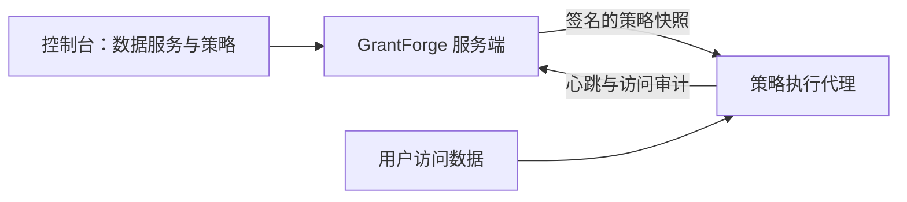

<!--
  Copyright (c) 2026 devlive-community/grantforge

  Licensed under the MIT License. See the LICENSE file in the
  project root for full license text.
-->

“数据权限”分组管理 GrantForge 以外的数据系统的权限，架构类似 Apache Ranger：插件定义服务类型，管理员在控制台写策略，访问链路上的代理下载策略并在本地判定访问。

> [!NOTE]
> 当前版本提供插件框架、通用策略编辑器、签名策略分发与访问审计，并包含 HDFS、ZooKeeper 和 MySQL 服务插件及配套代理。HDFS 的 Hadoop 版本适配范围见 [Apache Hadoop HDFS NameNode 代理](/external/hdfs-agent/)；MySQL 使用客户端连接的独立网络代理，见 [MySQL 代理](/external/mysql-agent/)。

## 插件

**平台管理 → 插件** 列出已加载的服务类型插件。内置插件随服务端提供，其他插件放入 `plugins` 目录后点击“重新扫描”即可；每个插件独立加载，出错只停用它自己。插件开发见 [插件与服务类型](/develop/plugins/)。

## HDFS

发行包内置 HDFS 服务类型插件，安装、连接配置、目录浏览与路径策略见 [Apache Hadoop HDFS](/plugins/hdfs/)。

## MySQL

MySQL 服务插件负责连接校验、数据库/表/列查询，以及访问、列脱敏和行过滤策略管理，见 [MySQL](/plugins/mysql/)。策略由独立部署的 [MySQL 代理](/external/mysql-agent/) 执行：客户端连接代理监听地址，由代理访问后端 MySQL。它不安装到 MySQL 服务器进程内；客户端直连后端会绕过 GrantForge 策略。

## 数据服务

**数据权限 → 数据服务**：一个服务是 GrantForge 管理权限的一个外部系统实例，例如一个 HDFS 集群。添加服务时选择服务类型，按插件定义的配置项填写连接信息，可以先 **测试连接**。密码等敏感配置加密保存，保存后不再显示。

## 策略

**数据权限 → 策略** 决定谁能对数据服务中的哪些资源做什么：

- **访问策略**允许或拒绝访问；
- **脱敏策略**遮盖字段；
- **行过滤策略**只放出部分行。

资源层级（如 MySQL 的库、表、列）、访问类型（如 select、update）和条件都来自服务类型的插件；填写资源时可以查找目标系统中实际存在的资源。策略的对象是用户、用户组或角色。

支持目录浏览的层级（如 HDFS 路径）旁有 **浏览** 按钮：可以逐级打开目录，查看所有者、组与权限，并一次选择多个文件或目录。查找或浏览失败时会显示具体原因（例如没有权限、无法连接或目录过大），可以重试。

## 代理

**数据权限 → 代理**：代理可嵌入目标系统，也可作为独立网络代理部署，凭令牌定期上报心跳并下载签名的策略快照，在本地判定访问。这里签发代理令牌（只显示一次）、查看各代理是否已用上最新策略。

## 访问审计

**数据权限 → 访问审计**：代理上报的每一次访问判定：谁在何时从哪里对哪个资源做了什么，被允许还是拒绝，由哪条策略决定。记录默认保留 90 天。

